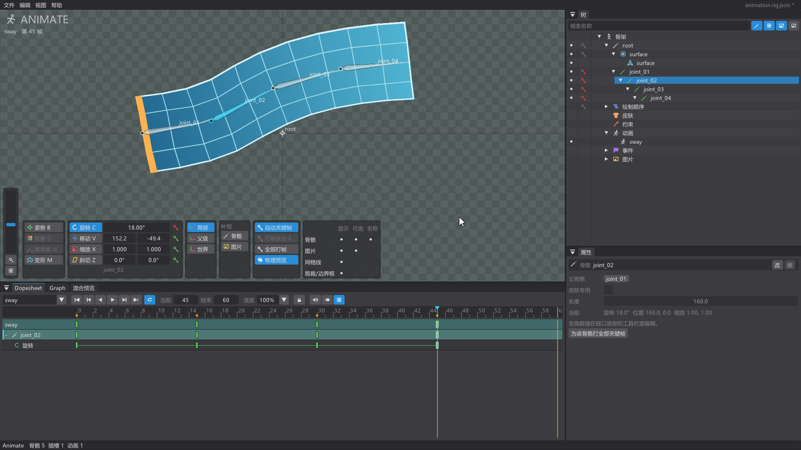

# Poseweaver

类 Spine 的 2D 骨骼动画编辑器（C++17 + Dear ImGui + GLFW + OpenGL）。设计见 [docs/DESIGN.md](docs/DESIGN.md)。



## 下载与体验

当前版本 **1.1.1**，提供 Windows x64 安装版和免安装压缩包：

- [下载最新发行版](https://github.com/ChariskQAQ/PoseWeaver/releases/latest)
- [观看骨骼动画制作演示](https://github.com/ChariskQAQ/PoseWeaver/releases/download/v1.1.1/Poseweaver-animation-demo-zh-1080p.mp4)
- [快速上手](docs/GETTING_STARTED.md) · [引擎接入](docs/ENGINE_INTEGRATION.md) · [实时骨骼运行时](docs/RUNTIME_INTEGRATION.md)

下载 `Poseweaver-1.1.1-win64.zip` 后解压运行 `Poseweaver.exe`，或运行 `Poseweaver-1.1.1-setup.exe` 安装。图片与 GIF 导出无需另装编码器；视频导出需要用户自行安装 FFmpeg。

源码、测试、示例及 Unity / Godot 插件均在本仓库。工程采用自有 `.rig.json` / `.pwskeleton` 格式，兼容范围见 [路线图](docs/ROADMAP.md)。Godot 实际导入、播放和独立导出已验收；Unity 目前通过程序集编译，Editor 导入、渲染和 Player 仍待实机验收，详见 [发布验收](docs/RELEASE_ACCEPTANCE.md)。

## 授权状态

项目自身暂未指定开源许可证。第三方组件保留各自的许可证，见 [第三方声明与许可全文](installer/THIRD_PARTY_NOTICES.txt)。

初次使用可从启动页打开“完整示例：机器人”，跟随 [上手教程](docs/GETTING_STARTED.md) 体验皮肤、IK、三个动作及引擎导出。

格式兼容按 [路线图](docs/ROADMAP.md) 分阶段验收；CPU/GPU 性能测量方法和 CSV 基线见 [PERFORMANCE.md](docs/PERFORMANCE.md)。绿色版包含 `rigcore_bench.exe`、`riggpu_bench.exe` 和 `rigeditor_bench.exe`。

## 功能

- 导入 PNG（拖进窗口或 文件 → 导入图片）
- 骨骼：建骨骼工具拖出骨骼链，层级面板拖拽改父级，旋转/移动/缩放工具
- Setup / Animate 双模式（Tab 切换）；Animate 模式下拖动骨骼自动打关键帧
- 网格：按图片轮廓自动生成（约束 Delaunay），Alt+点击加顶点、Del 删除，UV 跟随或变形模式
- 变形关键帧：Animate 模式下用网格工具拖顶点
- 剪裁、边界框、路径附件（插槽属性里 + 剪裁 / + 边界框 / + 路径）
- 约束：IK、变换、路径、物理（骨骼属性 → 新建约束，或树的“约束”节点右键），数值可打关键帧，物理实时预览并可烘焙
- 补偿：工具栏“补偿 → 骨骼/图片”，调整骨骼时子骨骼/附件保持原位
- 皮肤：树的“皮肤”节点新建/激活（可多选组合），附件“移入皮肤...”生成占位，占位属性里为每个皮肤换图/复制；骨骼与约束可设为皮肤专用
- 蒙皮：绑定多根骨骼并自动计算权重，笔刷涂抹（Ctrl 减少）、锁定骨骼、数值设置、平滑、修剪、左右镜像
- 时间轴：多动画、播放/倒放/循环/变速；Dopesheet 多选/框选、整体拖动、复制粘贴、右键改曲线；洋葱皮
- Graph 曲线编辑：贝塞尔手柄、缓入缓出等预设
- 斜切、插槽颜色关键帧、绘制顺序关键帧、事件（播放时在视口提示）
- 插槽混合模式：Setup 模式选中插槽，在属性里设置正常、叠加（发光）、正片叠底、滤色；支持撤销/重做、工程保存、合并和图片/视频导出。PSD 导入保留对应模式，其他模式会在问题面板提示。
- 混合预览：4 条轨道叠加播放，同轨道切换时淡入淡出（默认或按动画对设置时长）、队列、轨道权重、淡出到下层
- 音频：事件可挂 WAV / MP3 / FLAC，播放时同步发声，Dopesheet 显示波形，导出视频带声音
- 启动页（类似 Blender）：新建 / 从图片或 PSD 新建 / 示例、最近打开的文件、恢复上次的会话、快捷键；设置保存在 `%APPDATA%\RigEditor`
- 撤销/重做、保存/打开工程（`.rig.json`）；安全写入、30 秒自动恢复副本、切换工程与退出前的未保存确认
- 撤销与重做共享快照内存预算（默认 128 MiB、最多 200 步），可在“编辑 → 撤销内存预算”调整。
- 可选“收集工程资源”：保存时复制图片和事件音频，工程文件与资源文件夹可一起搬移；资源路径更新可整步撤销/重做
- 问题面板：检查缺失资源、无效引用、权重与动画数据，点击定位对象或顶点；支持后台扫描目录、显示已扫描数量及取消，预览候选后批量重定位图片与音频，整批操作可撤销。
- 光源与像素：可调位置、颜色、半径和强度的 2D 点光源，以及像素网格、色板限色、有序抖动和描边；支持选择 CPU / GPU 效果预览、记住选择、工程保存与撤销，导出自动烘焙。GPU 预览失败自动回退 CPU，导出保持 CPU。入口“视图 → 光源与像素...”，详见 [使用说明](docs/LIGHTING_PIXELS.md)。
- 导出：数据（JSON / 二进制 .rigb）、纹理打包（.atlas，可缩放 / 自动缩放到一页）、PNG / JPG 序列、精灵表、GIF、视频（MP4 / WebM / AVI / QuickTime MOV，需本机 ffmpeg）
- 普通图片与视频导出支持后台进度、取消、尺寸与内存预估、按工程记住配置及失败回滚；任务使用启动时的工程快照。序列可选清理清单记录且内容未变的多余旧帧。新增提交日志及启动时的中断恢复入口，恢复前检查输出修改；导出共享只读图片，减少启动复制开销。范围和安装、Unity 验收入口见 [RELEASE_ACCEPTANCE.md](docs/RELEASE_ACCEPTANCE.md)。
- Unity / Godot 接入：`.pwframes` 帧动画包，支持动作选择、独立循环、资源预算、按工程记住配置，以及后台导出进度和取消；附 Unity 导入器/播放器、Godot 原生动画精灵导入插件及示例。详见 [接入说明](docs/ENGINE_INTEGRATION.md)；另提供 Windows x64 `.pwskeleton` 实时骨骼，可换肤、控制骨骼、多轨混合和接收事件；详见 [实时接入](docs/RUNTIME_INTEGRATION.md)。Godot 已测试，Unity 待实测。
- 导入：PSD（按图层建插槽）、合并另一个工程或数据文件

待做功能与开发顺序见 [docs/ROADMAP.md](docs/ROADMAP.md)。

## 构建（Windows）

需要 Visual Studio 2022 Build Tools（含 C++ 工作负载与 CMake）。依赖会在首次配置时自动下载。

```bat
scripts\build.bat Release
```

产物：`build\Release\Poseweaver.exe`。脚本会顺带运行全部十二组检查：核心、运行时、文件安全、编辑流程、普通导出、中断恢复、命令行引擎导出、混合渲染、GPU 效果，以及编辑器、CPU 和 GPU 性能样例。

单独运行回归测试：`ctest --test-dir build\Release --output-on-failure`。编辑流程测试会建立隐藏 OpenGL 窗口，需要可用的图形环境；测试使用独立临时目录，不读取或覆盖用户工程和设置。

## 打包发布

```bat
scripts\package.bat
```

生成 `dist\Poseweaver-<版本>-win64\` 绿色版文件夹和同名 `.zip`（exe + samples + 说明 + 第三方许可）。
exe 静态链接 C++ 运行库、带图标与版本信息、不弹控制台窗口，解压到任何位置都能直接运行；
用户设置沿用 `%APPDATA%\RigEditor`，保留更名前的设置、最近文件与恢复会话。装有 [Inno Setup 6](https://jrsoftware.org/isinfo.php) 时还会生成安装包
`Poseweaver-<版本>-setup.exe`（开始菜单、可选桌面图标、卸载）。版本号取自 `CMakeLists.txt` 的 `project(... VERSION ...)`。

## 运行

```bat
build\Release\Poseweaver.exe
build\Release\Poseweaver.exe --demo samples\arm.png        :: 两骨骼蒙皮手臂 + wave 动画
build\Release\Poseweaver.exe path\to\project.rig.json
```

`--weights` / `--mesh` / `--clip` / `--ik` / `--path` / `--ghost` / `--bake` / `--skin` / `--mix` 以对应场景打开 demo（`--skin` 需要 `samples/arm_alt.png`），`--run <类型> <路径>` 无界面导入/导出后退出（类型：json、bin、atlas、png、jpg、sheet、gif、mp4、webm、avi、mov、merge、psd、engines），`--splash` 强制显示启动页，`--graph` 打开 Graph 视图，`--issues` 打开问题面板，`--time <秒>` 指定 demo 时间，`--screenshot out.png` 渲染几帧后截图退出（用于自动检查）。

## 保存与恢复

保存工程时先写入同目录临时文件并刷新，再替换目标文件；验证或写入失败时保留原工程。新建、打开、从启动页切换工程和退出都提供“保存并继续 / 放弃修改 / 取消”，保存失败或取消另存为时不会继续切换。

工程有修改时，每 30 秒在编辑操作结束后写入 `%APPDATA%\RigEditor\autosave.rig.json`，不覆盖正式工程。异常退出后再次启动会优先提示恢复；恢复内容作为未保存的副本打开，需另存为。成功保存、明确放弃当前工程或撤销回到已保存状态后清理其恢复副本。尚未处理的旧副本不会被新会话自动覆盖；损坏的副本保留供排查。

首次保存和“另存为”的 Windows 保存对话框提供“收集工程资源（图片和音频）”复选框；“文件 → 保存时收集工程资源”可设置普通保存的默认行为，初始关闭。勾选后，工程引用的全部图片和非空事件音频路径会复制到工程旁的 `<工程名>_assets` 文件夹，工程内保存相对路径。搬移时请一起复制 `.rig.json` 文件与这个资源文件夹。

原资源不会被移动或覆盖；同一源文件共用一份副本，同名的不同文件会避让。已在当前工程资源目录中的文件直接复用，新收集的外部资源放入新建的 `resources` / `resources_N` 子目录。缺失资源或复制、工程写入失败时不会提交新的引用、工程位置或撤销记录，并清理本次新建的副本。普通不收集资源的保存仍可保留缺失资源引用，方便后续修复。

收集成功后的路径更新作为一个撤销步骤；撤销仅恢复引用，不删除已复制的资源，以保留重做和旧版工程的可用性。保存位置使用独立历史标记：撤销离开保存点后显示未保存，重做到保存点后清除星号；在较早的撤销位置再次保存会移动保存点。没有发生数据变化的事务不会产生空撤销步骤。

在“视图 → 问题面板”查看检查结果，点击问题定位对象或顶点；缺失图片可在图片属性中“重新定位图片”，再“重新加载并检查”。缺失或无法解码的图片会阻止图集及图片、GIF、视频导出，避免生成不完整的画面。数据错误会阻止工程保存和数据导出；权重总和等可修复问题仅提示警告。

导入、保存、网格编辑和导出失败会保留在问题面板，不随状态栏提示消失。点击动画关键帧问题会选中对应对象并跳到出错时间，树面板会清除过滤并展开相关父级。面板下方显示完整原因、文件路径、动画时间和顶点编号，可复制详情；外部文件错误只展示相关文件，不会跳到无关对象。操作成功重试后清除对应失败记录，也可手动“清除操作记录”（不会清除仍存在的数据或资源问题）。状态栏的问题数量可直接打开面板。

## 界面

布局参考 Spine（见 [docs/UI.md](docs/UI.md)）：视口居中，左上角 SETUP/ANIMATE 标签点击切换模式；
视口底部浮动工具栏包含工具、变换数值与打帧按钮、坐标轴、自动关键帧和显示选项；右侧为树与属性/权重视图；
Animate 模式下方为 Dopesheet。打帧按钮：绿 = 无关键帧，橙 = 有未打帧改动，红 = 当前帧已有关键帧。

## 快捷键

| 键 | 作用 |
|---|---|
| Tab | Setup / Animate 切换 |
| C / V / X / Z | 旋转 / 移动 / 缩放 / 斜切 |
| B | 姿势工具（Ctrl+点击多选骨骼链，拖动时用 IK 摆整条链） |
| N / G | 建骨骼 / 权重（仅 Setup） |
| M | 网格工具：Setup 编辑顶点（Alt+点击加、Del 删），Animate 打变形关键帧 |
| 右键拖动、滚轮 | 平移、缩放视图；右键单击切回上一个工具 |
| F / Ctrl+F | 适配骨架 / 100% |
| Esc、双击空白 | 取消选择 |
| 空格 / ← → | 播放暂停 / 逐帧 |
| K | 为所有未打帧的改动打关键帧（关闭自动关键帧时） |
| F2 | 重命名所选 |
| Dopesheet 内：Ctrl 点击 / 拖框 / Ctrl+A | 多选关键帧；Del 删除，Ctrl+C / Ctrl+V 复制粘贴到当前帧；拖标尺上的黄色手柄按比例缩放 |
| Graph 内：滚轮 / Ctrl+滚轮 / 右键拖动 | 缩放时间 / 缩放数值 / 平移；选中插槽时显示颜色曲线 |
| Ctrl+Z / Ctrl+Y / Ctrl+S | 撤销 / 重做 / 保存 |
| Del | 删除所选 |

### 1.1.0 动画制作与实时接入

- Graph 的 X/Y、RGBA 可独立打帧、移动时间和调整缓动，见 [独立分量曲线](docs/COMPONENT_CURVES.md)。
- 同插槽关联网格共享几何与权重，支持跨皮肤来源及皮肤独立变形，见 [关联网格](docs/LINKED_MESHES.md)。
- 单骨骼 Setup 编辑、简单改名和附件/权重编辑采用局部撤销；结构修改和复杂补偿仍保留完整快照与保存位置。
- 使用以上新动画数据时保存格式升级为 v8；旧版不能读取 v8，请保留重要工程副本。

### 1.1.1 引擎接入修复

Godot 支持骨骼资源直接拖入场景，默认完整资源导出会携带数据、图片、音频和运行库；已验证 Windows 独立程序实际播放、绘制与混合模式。Unity 插件通过本机 Unity 6 程序集编译，修复初始化重复加载和失败保护；Editor 实机测试按决定等待授权。详见 [实时接入](docs/RUNTIME_INTEGRATION.md)。
